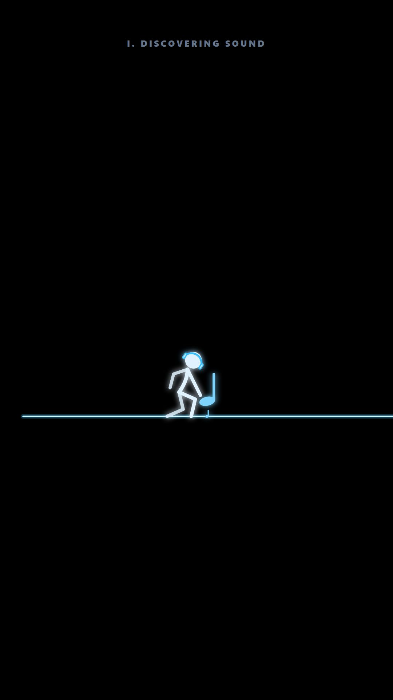
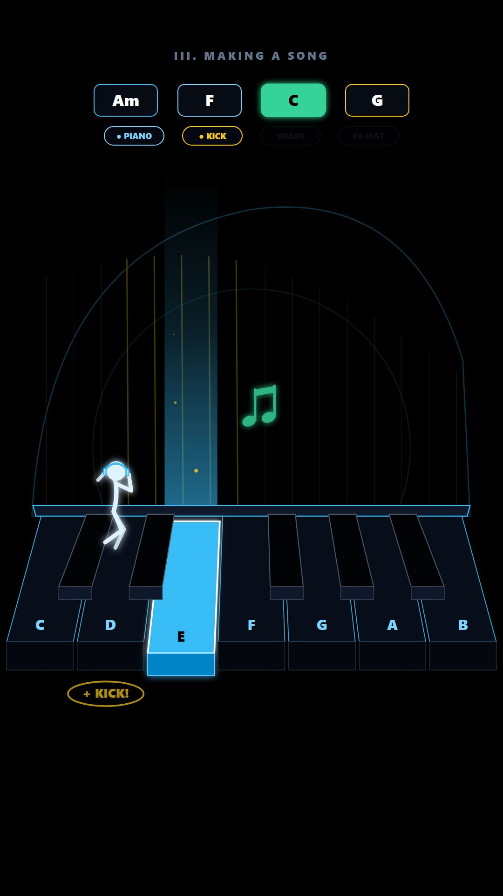
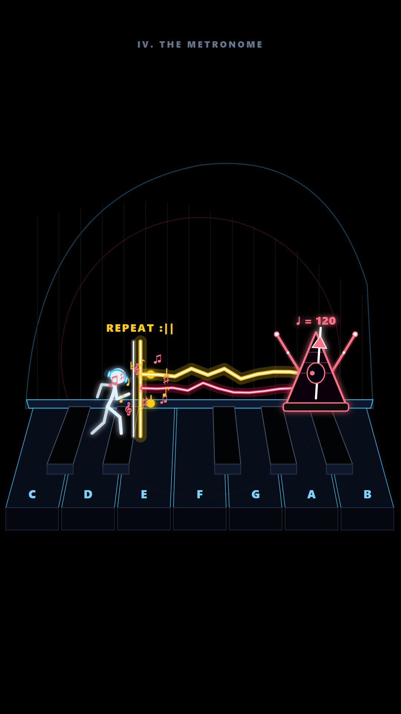
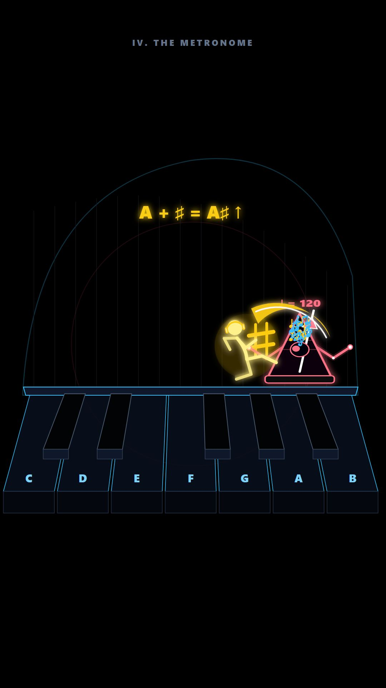
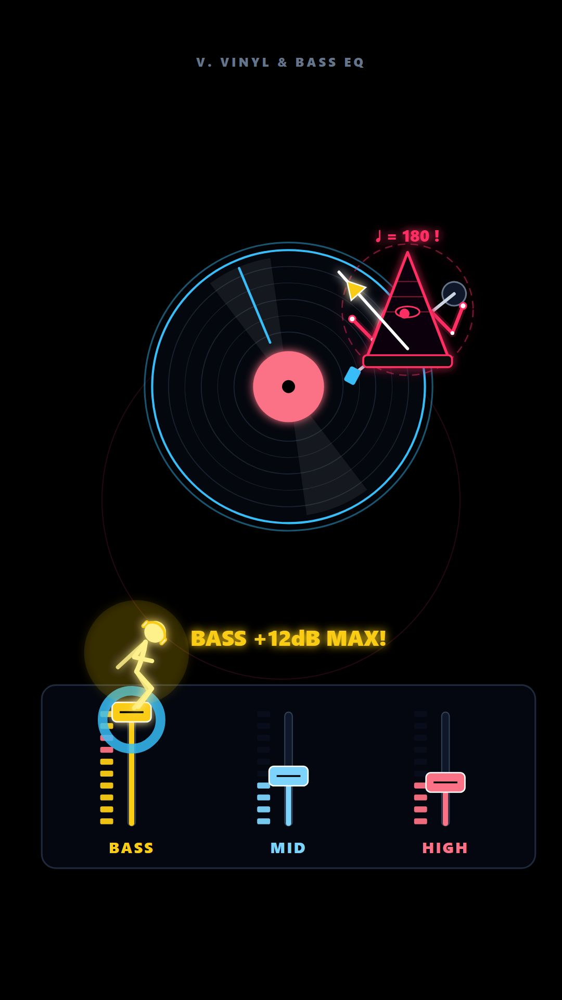
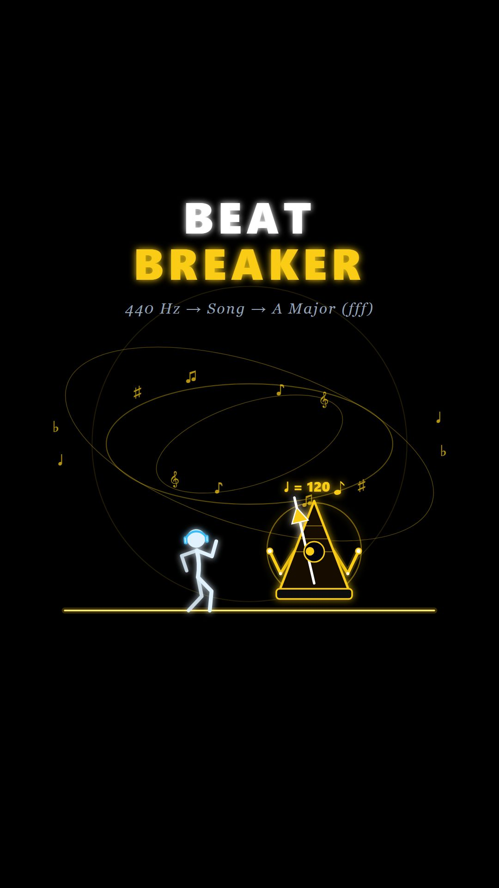

# Stickman vs. World — AI Agent Skill (`v3`)

> Direct, animate, and score original rule-driven **"Stickman vs. [Any Subject]"** animations (Math, Physics, Music, Electricity, Coding, Chemistry, Geometry, Finance, etc.) in **Remotion + SVG**, inspired by Alan Becker's *Animation vs.* series.

Works for both **9:16 vertical TikTok / Reels / Shorts (`1080×1920` @ 60fps)** and **16:9 widescreen YouTube (`1920×1080` @ 60fps)**.

---

## Showcase Example: `BEATBREAKER` (*Stickman vs. Music*, 90s · 9:16 · 60fps)

Built 100% end-to-end with this skill — pure `#000000` vector graphics, 2-bone IK physics motion, articulated boss (`<BossEye>` + 2-bone IK conductor arms), real recorded Yamaha C5 Concert Grand Piano + acoustic drums + real-buffer DJ vinyl scratch + full HitStop-synced Foley.

🎬 **Watch / Download Full 90s Demo Video (`1080×1920`, 60fps, Real Audio):**
👉 [**`examples/beatbreaker-v3/beatbreaker-v3-demo.mp4`**](./examples/beatbreaker-v3/beatbreaker-v3-demo.mp4)

| Curiosity Loop (`♩ = ♪+♪`) | 3D Grand Piano & Drum Pads | Repeat `:||` Reflection |
| :---: | :---: | :---: |
|  |  |  |

| `A + ♯ = A♯ ↑` Flush Kick | Vinyl & Studio LED EQ | Golden Harmony Finale |
| :---: | :---: | :---: |
|  |  |  |

Reference source code for this demo lives in [`examples/beatbreaker-v3/src/`](./examples/beatbreaker-v3/src/).

---

## Installation / วิธีติดตั้ง

### Option 1 — Quick Install via `skills` CLI (Works Across Supported Agents)
```bash
npx skills add Nathann-12/stickman-vs-world
```

### Option 2 — Install Manually by Copying `skills/stickman-vs-world`
Clone this repository and copy the `skills/stickman-vs-world` folder into your AI agent's global or project skills directory:

```bash
git clone https://github.com/Nathann-12/stickman-vs-world.git
```

| AI Agent / Tool | Destination Folder |
| :--- | :--- |
| **Antigravity (Global)** | Windows: `%USERPROFILE%\.gemini\config\skills\stickman-vs-world`<br>macOS/Linux: `~/.gemini/config/skills/stickman-vs-world` |
| **Codex (Global)** | Windows: `%USERPROFILE%\.codex\skills\stickman-vs-world`<br>macOS/Linux: `~/.codex/skills/stickman-vs-world` |
| **Claude Code (Global)** | Windows: `%USERPROFILE%\.claude\skills\stickman-vs-world`<br>macOS/Linux: `~/.claude/skills/stickman-vs-world` |
| **Cursor / Workspace Local** | `<your-project>/.agents/skills/stickman-vs-world` (or `.cursor/skills/stickman-vs-world`) |

#### Windows PowerShell One-Liners (Copy Straight After `git clone`)
```powershell
# For Antigravity
Copy-Item -Recurse -Force .\stickman-vs-world\skills\stickman-vs-world "$env:USERPROFILE\.gemini\config\skills\stickman-vs-world"

# For Codex
Copy-Item -Recurse -Force .\stickman-vs-world\skills\stickman-vs-world "$env:USERPROFILE\.codex\skills\stickman-vs-world"

# For Claude Code
Copy-Item -Recurse -Force .\stickman-vs-world\skills\stickman-vs-world "$env:USERPROFILE\.claude\skills\stickman-vs-world"
```

#### Codex `skill-installer` Direct GitHub Install
```bash
python install-skill-from-github.py --repo Nathann-12/stickman-vs-world --path skills/stickman-vs-world
```

> **Prerequisites for rendering animations:** Node.js 18+ and `ffmpeg` (used for decoding real acoustic samples and encoding final `.mp3`/`.mp4`).

---

## How to Use / ตัวอย่างคำสั่งใช้งาน

Once installed, start a fresh conversation with your AI agent and prompt naturally:

- **English:**
  > *"Use the `stickman-vs-world` skill to create a 90-second vertical 9:16 TikTok animation for **Stickman vs. Electricity** with logical circuit rules, seamless arena shifts, and real audio + Foley."*
  > *"Use `stickman-vs-world` to build a 60-second **Stickman vs. Chemistry** widescreen 16:9 Remotion animation."*
- **ภาษาไทย:**
  > *"ใช้สกิล `stickman-vs-world` สร้างแอนิเมชัน Stickman vs. ฟิสิกส์ แนวตั้ง 9:16 ความยาว 90 วินาที ลง TikTok ให้เล่าเรื่องสมเหตุสมผลและขยับลื่น ๆ"*
  > *"ใช้สกิล `stickman-vs-world` ทำคลิป Stickman vs. Coding 60 วินาที พร้อมเสียงจริงและ Foley"*

---

## What's Inside `skills/stickman-vs-world/`

```text
skills/stickman-vs-world/
├── SKILL.md                                         # 6 Non-Negotiable Craft Laws & 7-Stage Production Pipeline
├── references/
│   ├── storytelling-and-derivation.md               # 7-Step Derivation Ledger, 4 Anti-Clone Macro-Structures, Concept-Budget Rule & 5 Domain Blueprints
│   ├── stickman-motion-and-acting.md                # 5-Layer 2-Bone IK Motion Engine, 5 Alan Becker Acting Patterns & Contact Sync Math
│   ├── visual-arenas-and-svg-engineering.md         # Pure-Black 3-Color System, 9:16 TikTok Safe Zones, 2.5D Arenas & Chromium SVG Gotchas
│   ├── audio-and-foley-pipeline.md                  # Real Studio Sample Mixing, HitStop-Synced Foley Toolkit, DSP Gotchas & RMS Audit
│   └── qa-and-rendering.md                          # 12–16 Keyframe Visual Audit + 5-Frame Motion-Burst Check & Remotion Flags
└── assets/engine/                                   # Strict-TypeScript & Node.js Drop-In Starter Engine
    ├── ik.ts                                        # Analytic 2-Bone IK, HitStops + realTimeOf(), springImpulse(), elasticScale(), computeContactX()
    ├── cameraEngine.ts                              # Continuous multi-arena focus/zoom evaluator & pivot-safe SVG transform
    ├── rig.tsx                                      # Customizable StickmanBase, GPU-safe GlowFilterDefs, GlowLine, JaggedBeam, BossEye, ArticulatedLimb, Sakuga VFX
    ├── poseEngine.ts                                # Continuous evalPath, dynamic surface surfing, skid-braking, mid-motion emotions, floor-reach crouch, C¹ smoother
    ├── CompositionTemplate.tsx                      # End-to-end pre-wired Remotion composition skeleton
    ├── fetchRealSamples.mjs                         # Cross-platform fetcher for 21 real Yamaha C5 Grand Piano + Acoustic Drum + Bongo WAVs
    └── audioMixerTemplate.mjs                       # Stereo real-sample + HitStop-synced automatic footsteps + non-music Foley + real-buffer DJ rewind + RMS auditor
```

---

## License

MIT — feel free to use, remix, and share your own Stickman vs. World animations!
